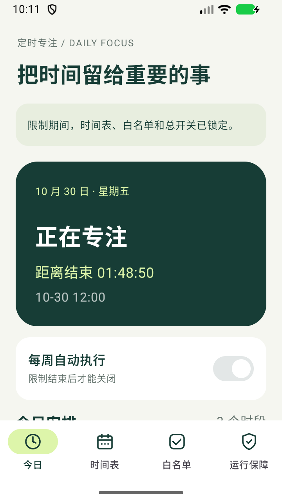
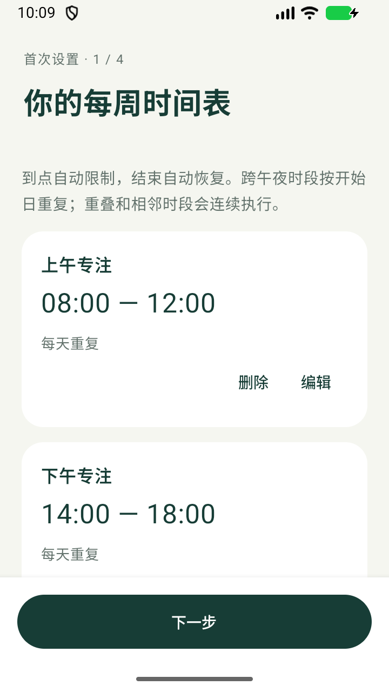
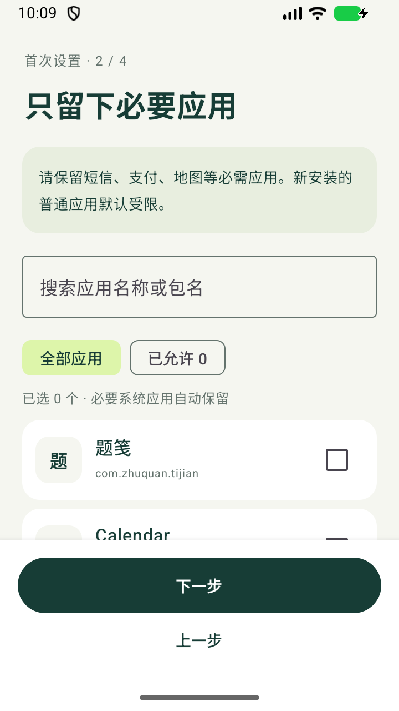
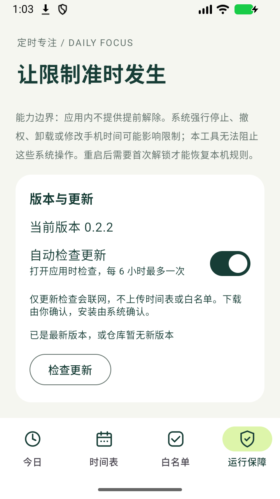
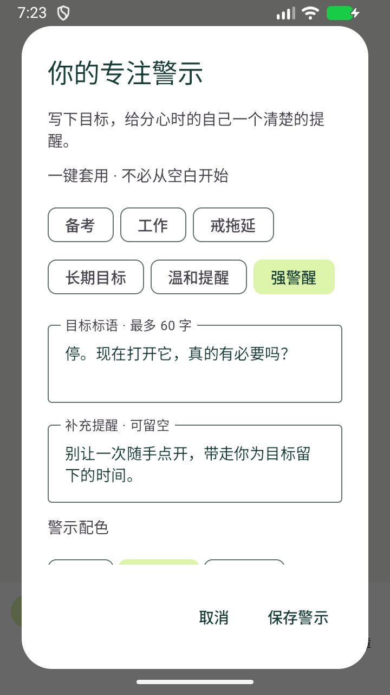
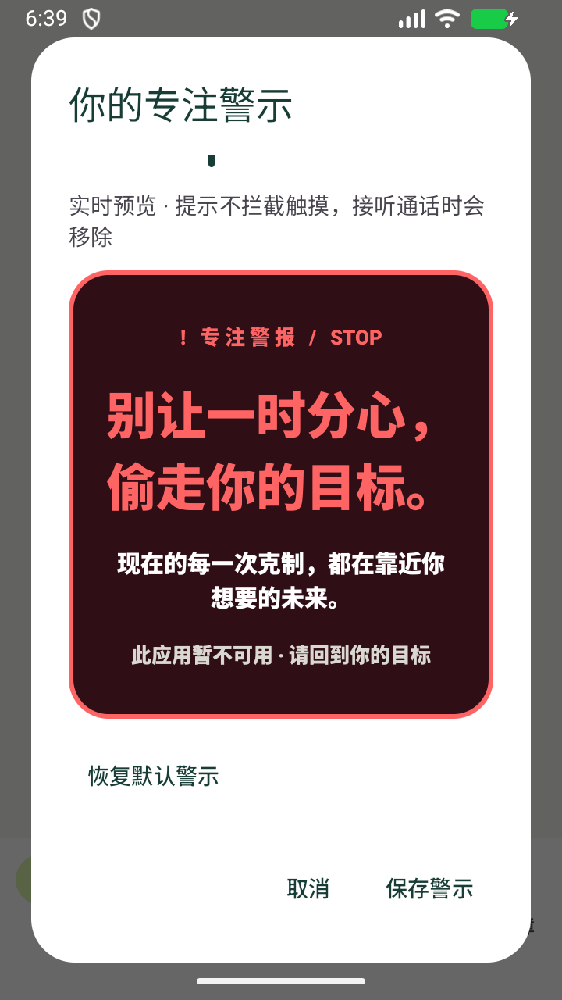
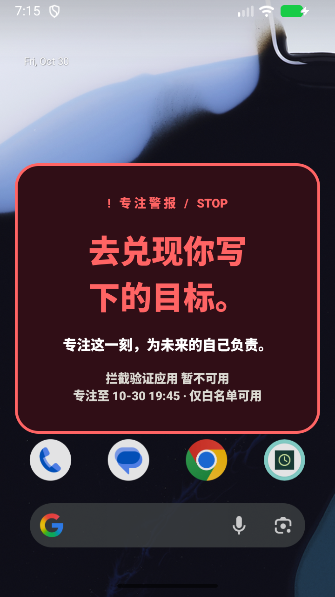

# 定时专注 · Scheduled Focus

**一次安排，到点专注，结束恢复。** 以每周时间表为核心的 Android 自律工具，无需每天手动开启番茄钟。

[下载最新版](https://github.com/zhuquan7237/scheduled-focus/releases/latest) · [使用与隐私](PRIVACY.md) · [反馈问题](https://github.com/zhuquan7237/scheduled-focus/issues) · [参与开发](CONTRIBUTING.md)

> 个人自用版本：包括 v0.2.2 在内的版本曾被 Google Play Protect 联网扫描标记，原因尚未确认，不能称为误报或代表通过安全审核。已在模拟器中通过系统提供的手动确认完成 0.2.1 → 0.2.2 覆盖安装，没有关闭系统保护；时间表和白名单保留。详见 [安装检查记录](docs/INSTALL_REVIEW.md)。

| 今日 | 时间表 | 白名单 | 运行保障与更新 |
| --- | --- | --- | --- |
|  |  |  |  |

## 功能

- 每周重复时段，支持跨午夜，重叠与相邻时段连续执行。
- 全局白名单，可搜索、筛选；新安装的普通应用默认受限。
- 微信受限时，打开普通页面才开始 2 分钟使用，到期冷却 5 分钟；冷却结束后等下一次打开再开始计时。已识别的通话页面单独放行，真实微信版本兼容性需真机验证。
- 限制期间锁定时间表、白名单与总开关，没有临时放行入口。
- 自定义目标标语、补充提醒、警示配色、字体、字号与停留时间，支持实时预览。
- 内置备考、工作、戒拖延、长期目标、温和提醒、强警醒六套标语与推荐样式，一键套用后仍可修改。
- 默认隐藏最近任务卡片，保留桌面图标和系统管理入口；不等于系统级保活。
- 本地保存，无账号、广告或使用统计。
- 应用内检查 GitHub 新版本、下载安装包并交由系统确认安装。

**当前为早期版本。模拟器已经验证，HyperOS 真机仍待验证。** 正常安装无法防止系统强停、撤权或卸载。

微信规则、通话兼容范围、警示定制和测试夹具说明见 [v0.3.0 使用说明](docs/V030.md)。

| 一键套用预设 | 警示预览 | 实际拦截卡片 |
| --- | --- | --- |
|  |  |  |

独立的 Kotlin / Jetpack Compose 应用，包名 `com.zhuquan.scheduledfocus`。Android 8.0（API 26）及以上，当前 compile / target SDK 35。

## 使用

1. 设置每周重复时段，默认提供 08:00–12:00、14:00–18:00、20:00–23:00，每个时段可单独选星期。
2. 搜索并选择统一白名单，提前保留短信、支付、地图、学习工具等必需应用。
3. 开启无障碍服务及闹钟与提醒权限。通知为可选项；建议开启自启动并取消后台省电限制。
4. 确认启用。如果当前时间被覆盖，会再次提示即将立即限制。

首页展示今日时段、状态、距离下次开始或结束的时间。限制时段中，所有设置修改都会被存储层拒绝；编辑框即使在开始前打开，也不能在到点后保存。空闲时可修改，当天生效。

## 规则

- 开始时间包含，结束时间不包含；跨午夜按开始日的星期重复。
- 重叠和相邻时段合并执行，不产生短暂解除。连续覆盖整周时显示无空闲间隔，不给出虚假的结束时间。
- 按手机当前本地时间执行，时区或系统时间变化后重新计算。夏令时缺失时间向后平移，重复时间取较早偏移；平移后结束不晚于开始的单次时段跳过。
- 新安装的普通应用默认受限。电话默认拨号器、桌面、已启用输入法、系统设置、系统界面和必要的授权/安装交互自动保留。系统设置用于管理授权、停止和卸载，不加以阻拦；严格锁定仅作用于本应用内的规则修改。应用内没有临时放行。
- 微信是明确的固定规则例外：受限时提供连续 120 秒额度及 300 秒冷却。离开不暂停，重连不重置，手机重启后保守恢复 5 分钟冷却；微信已加入白名单则不执行额度限制。
- 用无障碍服务识别前台包名与微信窗口类名并返回桌面，不读取页面文字。时间表、白名单、标语和微信额度不上传；联网仅用于 GitHub 更新。

## 应用内更新

在「运行保障 → 版本与更新」管理更新。自动检查默认开启：打开应用时每 6 小时最多查询一次最新正式 Release；也可关闭或手动检查。优先读取仓库中由发布工作流自动维护的 `updates/latest.json`，避免共享网络出口耗尽 GitHub REST API 额度；静态来源不可用时尝试 REST API。不会自动下载或静默安装。

发现新版本后显示说明与大小，点击下载后交由 Android 下载管理器执行，离开页面也能继续。下载完成后校验大小、GitHub 提供的 SHA256（如有）、包名、签名及版本号，再交给系统安装；如需允许此来源安装，请授权后返回重试。限制期间不能启动安装。网络不可用时保留本机时间表，允许稍后重试。

更新源固定为本仓库的 GitHub 正式 Release，仅接受 `vX.Y.Z` 或 `X.Y.Z` 标签和 `scheduled-focus-vX.Y.Z.apk` 附件。开发者发布约定见 CONTRIBUTING。

## 构建

需要 JDK 17 和 Android SDK 35。在本目录配置 `local.properties` 中的 `sdk.dir`，或设置 `ANDROID_HOME`。Gradle Wrapper 已包含。

Windows 可直接运行 `./scripts/build.ps1`，执行规则测试、静态检查和 release 构建，将 APK 和 SHA256 输出至 `dist`。传入 `-EmulatorTests` 可追加模拟器集成测试。

`-FullWeChatCycle` 额外执行真实等待 2 分钟 + 5 分钟的微信规则测试，需要提前在模拟器安装显式构建的 testOnly 夹具；测试真实微信来电仍需登录手机，不能用此夹具替代。

PowerShell：

```powershell
$env:JAVA_HOME = 'C:/Program Files/Microsoft/jdk-17.0.20.101-hotspot' # 按实际安装位置修改
# Windows 的中文源目录可能让 JDK 17 的 Gradle 测试参数文件无法正确解析类路径。
# 将构建输出设为英文路径；源代码仍保留在原位置。
$env:FOCUS_BUILD_ROOT = "$env:LOCALAPPDATA/Temp/scheduled-focus-build"
.\gradlew.bat :app:testDebugUnitTest :app:lintDebug :app:assembleRelease --console=plain
```

设置 `FOCUS_BUILD_ROOT` 后，APK 位于 `$env:FOCUS_BUILD_ROOT/app/outputs/apk/release/app-release.apk`。不设置时输出到 `app/build`。Linux / macOS 使用 `./gradlew`，通常无需设置外部输出目录。

release 使用保存在仓库外的固定签名文件。为使最初 v0.1.0 测试安装可以覆盖升级，保留其证书身份；后续发布必须沿用同一私钥。签名文件不包含在源码中。自行构建 debug 版不需要发布私钥；自行签名的包无法覆盖官方签名版本。

本机 release 构建默认从 `~/.codex/signing/scheduled-focus.jks` 读取；可通过 `FOCUS_KEYSTORE`、`FOCUS_STORE_PASSWORD`、`FOCUS_KEY_ALIAS`、`FOCUS_KEY_PASSWORD` 指定自己的签名。GitHub 标签发布工作流通过仓库加密 Secrets 恢复签名并构建 APK 与 SHA256。请妥善离线备份私钥，丢失后不能再提供同签名覆盖更新。

## 验证

纯 JVM 测试覆盖示例边界、星期、跨午夜、重叠相邻合并、整周连续、今日列表、时区/夏令时、时间跳变、保存锁和立即生效确认。

模拟器集成测试：

```powershell
.\gradlew.bat :app:connectedDebugAndroidTest --console=plain
```

集成测试只在模拟器执行自动系统设置操作，真实设备会跳过；会修改本应用测试数据，临时开启其无障碍服务和精确定时权限，并在结束时恢复原无障碍设置。行为测试会跨越真实的两个分钟边界，约需 1–3 分钟：

- 验证设置序列化，以及锁定修改不会写入磁盘。
- 在空闲期打开独立的普通测试应用，等到开始边界验证自动退回桌面，再验证再次打开会被拦截。
- 验证白名单时钟、本应用及系统设置仍可使用，结束后普通测试应用恢复可用。
- 关闭无障碍服务后验证状态变为未就绪。
- 首次设置导航、编辑对话框、系统返回和缺少权限时不能进入下一步。

HyperOS 真机验收步骤见 [docs/VALIDATION.md](docs/VALIDATION.md)。

## 工程结构

- `ScheduleEngine`：纯 Kotlin 时间判断、连续时段和修改策略。
- `FocusStore`：一个本地设置快照；写入前按当前时刻重新验证锁定状态。
- `FocusAccessibilityService` / `EssentialApps`：前台应用拦截、必要系统应用识别、拦截说明浮层。
- `RuntimeSupport` / `ScheduleReceiver`：边界定时、开机/升级/时间变更重算及状态通知。
- `MainActivity`：首次四步设置、今日、时间表、白名单和运行保障。

## 能力边界

这是普通安装的自律工具，并非设备管理员或系统级应用停用工具。不能保证阻止系统强停、撤权、卸载、清除数据、安全模式和修改时间等绕过；不会停止其他应用的后台运行。启动器中的内嵌内容、白名单浏览器内的网页和必要系统交互也不能细分限制。

开机后首次解锁时才恢复本地规则。无障碍服务被系统关闭、厂商省电杀进程或权限被撤回时，拦截可能失效；运行保障按实际服务连接和精确定时权限显示就绪状态，不能替代真机检查。

本次交付不会把模拟器结果标为 HyperOS 真机通过。
